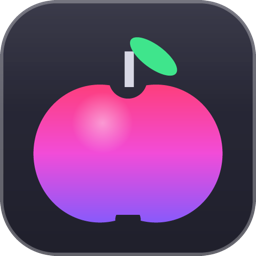

<p align="center"></p>

<h1 align="center">Pomme</h1>

<p align="center"><b>Ein schlanker Musikplayer für Apple Music und lokale Audiodateien: Songtexte, Equalizer, Miniplayer.</b></p>

<p align="center"> <a href="https://github.com/jeremdevgit/pomme/releases"></a> <a href="LICENSE"></a> <a href="https://github.com/jeremdevgit/pomme/actions/workflows/windows.yml"></a></p>

<p align="center"><a href="README.md">English</a> · <a href="README.fr.md">Français</a> · <a href="README.es.md">Español</a> · <b>Deutsch</b> · <a href="README.it.md">Italiano</a> · <a href="README.pt.md">Português</a> · <a href="README.zh.md">简体中文</a> · <a href="README.ja.md">日本語</a></p>

<p align="center"><a href="https://github.com/jeremdevgit/pomme/releases/latest"><b>⬇ Herunterladen</b></a></p>


Apple Music und deine eigenen Audiodateien im selben Fenster, in einer App von rund zehn Megabyte – **ohne Electron**.

## Auf einen Blick

| | |
|---|---|
| **Kategorie** | 🎮 Musik & Spiele |
| **Plattformen** | Windows |
| **Oberfläche** | 8 Sprachen (EN, FR, ES, DE, IT, PT, ZH, JA) |
| **Preis** | Kostenlos, quelloffen, ohne Werbung und Telemetrie |
| **Status** | Stabil |
| **Lizenz** | [GPL-3.0-or-later](LICENSE) |

## Funktionen

- **Apple Music** (Abo erforderlich): Jetzt hören, Entdecken, Radio, deine Mediathek und Playlists, Suche, Playlists erstellen.
- **Deine Dateien**: FLAC, ALAC, MP3, AAC/M4A, Ogg Vorbis, WAV, AIFF, CAF, MKA … mit Covern, Alben und Künstlern; Drag & Drop; Hi-Res-Wiedergabe.
- **Synchronisierte Songtexte** im Vollbild (Apple Music oder LRCLIB für lokale Titel – abschaltbar).
- 10-Band-**Equalizer** mit Voreinstellungen, Lautstärkeausgleich, Wahl des Audioausgangs, Wiedergabequalität.
- **Miniplayer**, Sleep-Timer, Medientasten und Windows-Steuerung, Infobereich, Autostart.
- Optional **Discord-Status** und **Netzwerk-Streaming** zu einem kompatiblen Empfänger im selben Netz (Windows 11).

<p> </p>

## Loslegen

1. Lade `Pomme-Setup.exe` aus der [neuesten Version](https://github.com/jeremdevgit/pomme/releases/latest) und starte es. Pomme installiert sich **für dein Konto, ohne Administratorrechte**, und ersetzt eine ältere Version; Mediathek, Einstellungen und Apple-Music-Anmeldung bleiben erhalten.
2. Melde dich auf Apples offizieller Seite bei Apple Music an oder ziehe deine Musikordner ins Fenster.
3. Deinstallieren über *Einstellungen › Apps*, mit oder ohne Löschen der Mediathek.

Voraussetzungen: Windows 10 oder 11 mit WebView2 (in Windows 11 enthalten). Kein kostenpflichtiges Zertifikat: Wenn SmartScreen erscheint, wähle **Weitere Informationen › Trotzdem ausführen**. Prüfen mit `Get-FileHash` und `SHA256SUMS.txt`. Stille Installation: `Pomme-Setup.exe /S`.

## Datenschutz

- **Keine Telemetrie, kein Pomme-Konto.** Deine Apple-Music-Sitzung bleibt im Pomme-Profil auf deinem PC.
- Kontaktierte Dienste: Apple Music; LRCLIB für lokale Songtexte (nur Titel und Künstler, abschaltbar); Discord lokal, wenn der Status aktiv ist. Netzwerk-Streaming startet erst nach Auswahl eines Geräts.
- Pomme enthält keinen Apple-Schlüssel: Wie Apples Web-Player nutzt es das öffentliche Token von music.apple.com.

## Selbst bauen

```powershell
# Rust stable + Visual Studio Build Tools (C++)
cargo build --release        # target\release\Pomme.exe
.\tools\release.ps1          # dist\Pomme-Setup.exe + Prüfungen
```

Die Übersetzungen stehen in `ui/textes/<Sprache>.js` (französischer Text als Schlüssel). Versionen werden mit GitHub Actions gebaut ([`windows.yml`](.github/workflows/windows.yml)).

## Lizenz

GNU GPL v3 oder später – siehe [LICENSE](LICENSE). Pomme ist weder mit Apple verbunden noch von Apple unterstützt; Apple Music ist eine Marke von Apple Inc. Die Rust-Bibliotheken (symphonia, cpal, wry, tao …) stehen unter MIT / Apache-2.0 / MPL-2.0.

---

Eine Sicherheitslücke gefunden? Bitte privat melden (siehe [SECURITY.md](SECURITY.md)), nicht in einem öffentlichen Issue.

## Weitere freie Software von jeremdevgit

Alle kostenlos, quelloffen und werbefrei.

**🛠️ System & Hardware** — [Boîte à outils](https://github.com/jeremdevgit/boite-a-outils) · [rJb](https://github.com/jeremdevgit/rjb) · [LJ Hub](https://github.com/jeremdevgit/lj-hub) · [Decklight](https://github.com/jeremdevgit/decklight)

**📒 Produktivität & Daten** — [Carnet de notes](https://github.com/jeremdevgit/carnet-rust) · [JMeca](https://github.com/jeremdevgit/jmeca) · [Suite Libre](https://jeremdevgit.github.io/suite-libre/)

**🎮 Musik & Spiele** — [Ludothèque](https://github.com/jeremdevgit/ludotheque) · [AutoDex](https://github.com/jeremdevgit/autodex) · [Batailles de France](https://github.com/jeremdevgit/batailles-de-france)
