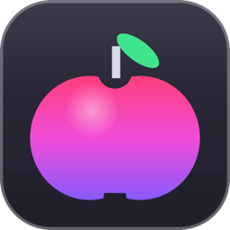
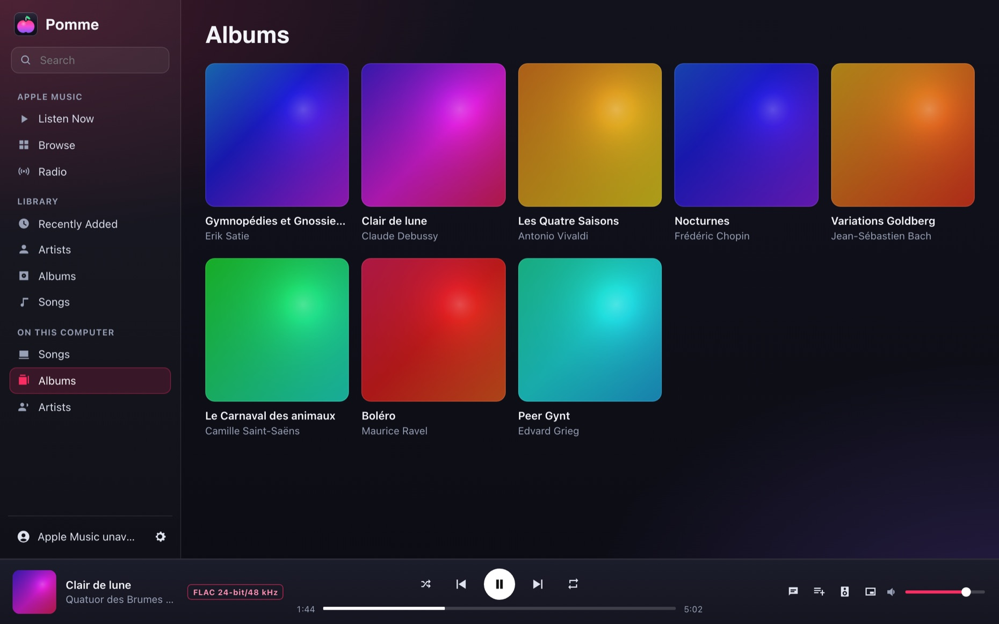
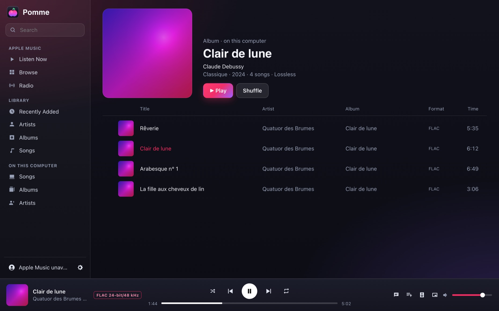
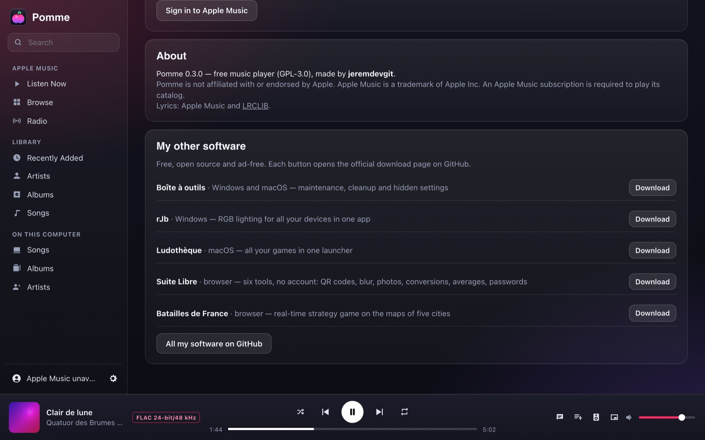
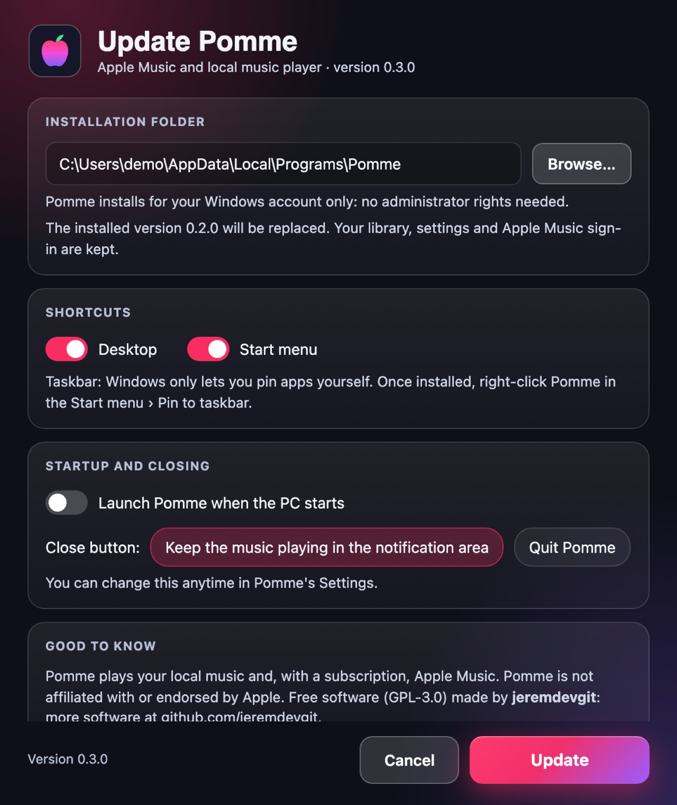

<p align="center"></p>

# Pomme

[English](README.md) · [Français](README.fr.md) · **Español**

**Un reproductor de música ligero para Windows: Apple Music y tus archivos de audio locales en la misma ventana.** Biblioteca, playlists, letras sincronizadas, ecualizador, minirreproductor, teclas multimedia, estado de Discord — en una aplicación de unos diez megabytes, sin Electron.

**8 idiomas**: español, inglés, francés, alemán, italiano, portugués, chino y japonés. El idioma de Windows se elige automáticamente; *Ajustes › Idioma* permite cambiarlo (el menú del área de notificación también cambia).

👉 **[Descargar Pomme para Windows](https://github.com/jeremdevgit/pomme/releases/latest)** (`Pomme-Setup.exe`)



## Funciones

- **Apple Music** (se necesita suscripción): Escuchar ahora, Explorar, Radio, tu biblioteca y tus playlists, búsqueda, creación de playlists.
- **Música del ordenador**: FLAC, ALAC, MP3, AAC/M4A, Ogg Vorbis, WAV, AIFF, CAF, MKA… con portadas, álbumes y artistas; arrastrar y soltar carpetas o archivos; reproducción en alta resolución (el formato se muestra durante la reproducción).
- **Letras sincronizadas** a pantalla completa (Apple Music, o LRCLIB para las canciones locales; se puede desactivar).
- **Ecualizador** de 10 bandas con preajustes, normalización del volumen, elección de la salida de audio, calidad de reproducción ajustable.
- **Minirreproductor**, temporizador de apagado, teclas multimedia y controles de Windows, área de notificación, inicio con el PC.
- **Estado de Discord** («Escuchando…») con título, artista, portada y progreso, si lo deseas.

<p> </p>

La transmisión de red requiere Windows 11 y un receptor compatible en la misma red local. No se garantizan la asociación AirPlay con PIN ni la reproducción de contenido protegido.

## Instalar

1. Descarga `Pomme-Setup.exe` desde la página [Releases](https://github.com/jeremdevgit/pomme/releases/latest) y ejecútalo.
2. Pomme se instala **para tu cuenta de Windows, sin permisos de administrador**. **Una versión ya instalada se sustituye automáticamente**: se conservan la biblioteca, los ajustes y la sesión de Apple Music.
3. Para desinstalar: *Configuración › Aplicaciones* (a elegir: conservar o borrar biblioteca y ajustes).



El ejecutable no está firmado con un certificado de pago: si Windows SmartScreen muestra «Windows protegió su PC», haz clic en **Más información** y luego en **Ejecutar de todas formas**. Para comprobar el archivo: `Get-FileHash .\Pomme-Setup.exe` y compáralo con `SHA256SUMS.txt`. Instalación silenciosa: `Pomme-Setup.exe /S`.

Requisitos: Windows 10 u 11 con el motor WebView2 (incluido en Windows 11).

La transmisión de red requiere Windows 11 y un receptor compatible en la misma red local. No se garantizan la asociación AirPlay con PIN ni la reproducción de contenido protegido.

## Privacidad y seguridad

- La transmisión de red solo se inicia al seleccionar un dispositivo. Una dirección local temporal envía el audio de Pomme al receptor.

- **Sin telemetría ni cuenta de Pomme.** El inicio de sesión en Apple Music se hace en la página oficial de Apple; la sesión se queda en el perfil de Pomme en tu PC.
- **Servicios contactados**: Apple Music (catálogo, reproducción, letras), LRCLIB para las letras de las canciones locales (se envían título y artista; se puede desactivar), Discord en local si el estado está activado.
- La interfaz solo acepta órdenes de sus propias páginas; los enlaces externos se abren en tu navegador.
- Pomme no incluye ninguna clave de Apple: como el reproductor web de Apple Music, usa el token público que publica music.apple.com.

¿Has encontrado una vulnerabilidad? Lee [SECURITY.md](SECURITY.md).

## Compilar

Requisitos: [Rust](https://rustup.rs) estable y las *Build Tools* de Visual Studio («Desarrollo para el escritorio con C++»).

```powershell
cargo build --release          # target\release\Pomme.exe (renombrado Pomme-Setup.exe, instala)
.\tools\release.ps1            # dist\Pomme-Setup.exe + comprobaciones (sin rutas ni identificadores de la máquina, sin dependencia del Runtime de Visual C++)
```

Las versiones publicadas las construye GitHub Actions ([`.github/workflows/windows.yml`](.github/workflows/windows.yml)).

## Traducciones

La interfaz elige su idioma (elección guardada, si no idioma de Windows, si no inglés) y se traduce una vez al cargarse. Los textos están en `ui/textes/<idioma>.js`, donde el texto francés sirve de clave; solo se carga el idioma elegido. Los pocos textos que muestra el propio Windows (menú del área de notificación, selector de carpeta, instalador) están en `src/langue.rs` y `ui/setup.html`.

## Estructura del repositorio

```
src/          programa (Rust): ventana WebView2, reproducción de audio (symphonia, cpal), biblioteca local, instalador
ui/           interfaz (HTML, CSS, JavaScript sin framework); ui/textes: traducciones
tools/        construcción de la versión distribuida
captures/     capturas de pantalla (biblioteca ficticia de obras de dominio público; captures/en: interfaz en inglés)
```

## Licencia

Código bajo licencia **GNU GPL v3 o posterior**: consulta [LICENSE](LICENSE). Copyright © 2026 jeremdevgit.

Pomme no está afiliado ni respaldado por Apple. Apple Music es una marca de Apple Inc. Las bibliotecas de Rust utilizadas (symphonia, cpal, wry, tao…) están bajo licencias MIT / Apache-2.0 / MPL-2.0; la lista completa figura en `Cargo.lock`.

## Mis otros programas

Todos libres, gratuitos y sin publicidad — [github.com/jeremdevgit](https://github.com/jeremdevgit):

| Programa | Plataforma | En resumen |
|---|---|---|
| [AutoDex](https://github.com/jeremdevgit/autodex) | Windows, macOS, Linux | Juego de colección de coches con reconocimiento de fotos en el dispositivo |
| [Boîte à outils](https://github.com/jeremdevgit/boite-a-outils) | Windows, macOS | Mantenimiento del ordenador, limpieza y búsqueda de archivos |
| [Carnet de notes](https://github.com/jeremdevgit/carnet-rust) | Windows | Cuadernos cifrados y sincronización experimental |
| [Decklight](https://github.com/jeremdevgit/decklight) | Windows, macOS, Linux | Stream Deck virtual con control USB |
| [JMeca](https://github.com/jeremdevgit/jmeca) | Windows, macOS, Linux | Seguimiento de mantenimiento de vehículos cifrado |
| [LJ Hub](https://github.com/jeremdevgit/lj-hub) | Windows, macOS, Linux | Gestor de perfiles para dispositivos Logitech |
| [rJb](https://github.com/jeremdevgit/rjb) | Windows | Control de la iluminación RGB |
| [Ludothèque](https://github.com/jeremdevgit/ludotheque) | macOS | Biblioteca y lanzador de juegos |
| [Suite Libre](https://jeremdevgit.github.io/suite-libre/) | Navegador | Seis herramientas sin cuenta |
| [Batailles de France](https://github.com/jeremdevgit/batailles-de-france) | Navegador | Juego de estrategia en tiempo real |
