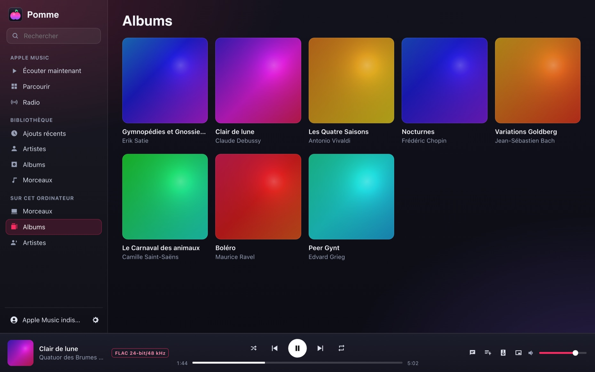
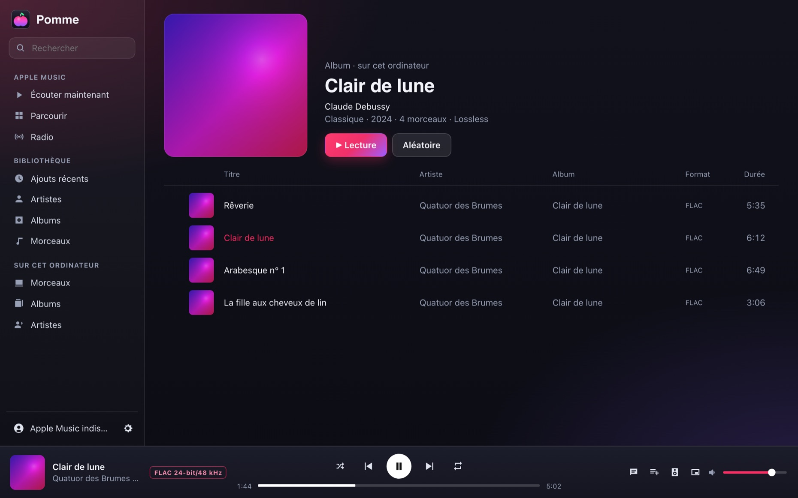
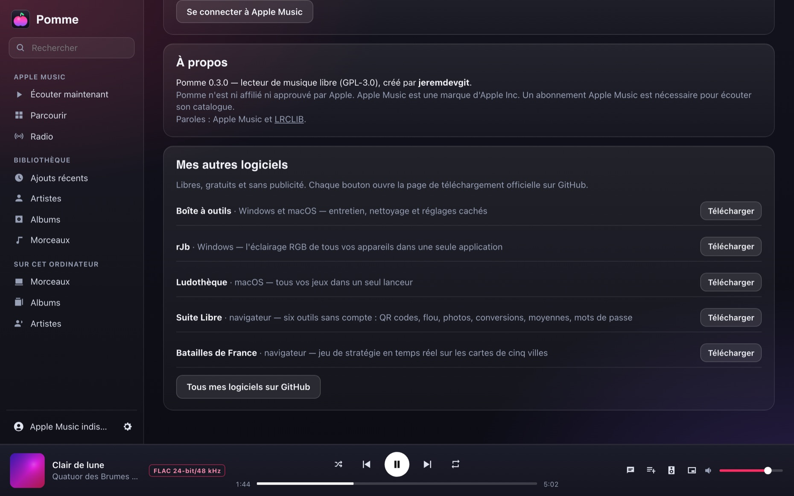

<p align="center"></p>

<h1 align="center">Pomme</h1>

<p align="center"><b>Un lecteur de musique léger pour Apple Music et vos fichiers audio : paroles, égaliseur, mini-lecteur.</b></p>

<p align="center"> <a href="https://github.com/jeremdevgit/pomme/releases"></a> <a href="LICENSE"></a> <a href="https://github.com/jeremdevgit/pomme/actions/workflows/windows.yml"></a></p>

<p align="center"><a href="README.md">English</a> · <b>Français</b> · <a href="README.es.md">Español</a> · <a href="README.de.md">Deutsch</a> · <a href="README.it.md">Italiano</a> · <a href="README.pt.md">Português</a> · <a href="README.zh.md">简体中文</a> · <a href="README.ja.md">日本語</a></p>

<p align="center"><a href="https://github.com/jeremdevgit/pomme/releases/latest"><b>⬇ Télécharger</b></a></p>



Apple Music et vos propres fichiers audio dans la même fenêtre, dans une application d'une dizaine de mégaoctets — **sans Electron**.

## En bref

| | |
|---|---|
| **Catégorie** | 🎮 Musique et jeux |
| **Plateformes** | Windows |
| **Interface** | 8 langues (EN, FR, ES, DE, IT, PT, ZH, JA) |
| **Prix** | Gratuit, open source, sans publicité ni télémétrie |
| **État** | Stable |
| **Licence** | [GPL-3.0-or-later](LICENSE) |

## Fonctions

- **Apple Music** (abonnement requis) : Écouter, Explorer, Radio, votre bibliothèque et vos playlists, recherche, création de playlists.
- **Vos fichiers** : FLAC, ALAC, MP3, AAC/M4A, Ogg Vorbis, WAV, AIFF, CAF, MKA… avec pochettes, albums et artistes ; glisser-déposer ; lecture haute résolution.
- **Paroles synchronisées** en plein écran (Apple Music, ou LRCLIB pour les morceaux locaux — désactivable).
- **Égaliseur** 10 bandes avec préréglages, normalisation du volume, choix de la sortie audio, qualité de lecture.
- **Mini-lecteur**, minuterie de veille, touches multimédia et contrôles Windows, zone de notification, lancement au démarrage.
- **Statut Discord** et **diffusion réseau** vers un récepteur compatible du même réseau (Windows 11), si vous le souhaitez.

<p> </p>

## Pour commencer

1. Téléchargez `Pomme-Setup.exe` depuis la [dernière version](https://github.com/jeremdevgit/pomme/releases/latest) et lancez-le. Pomme s'installe **pour votre compte, sans droits administrateur**, et remplace une ancienne version en gardant bibliothèque, réglages et connexion Apple Music.
2. Connectez-vous à Apple Music sur la page officielle d'Apple, ou déposez vos dossiers de musique dans la fenêtre.
3. Désinstallation depuis *Paramètres › Applications*, en gardant ou en effaçant votre bibliothèque.

Configuration : Windows 10 ou 11 avec WebView2 (inclus dans Windows 11). Pas de certificat payant : si SmartScreen s'affiche, choisissez **Informations complémentaires › Exécuter quand même**. Vérifiez avec `Get-FileHash` et `SHA256SUMS.txt`. Installation silencieuse : `Pomme-Setup.exe /S`.

## Confidentialité

- **Ni télémétrie, ni compte Pomme.** Votre session Apple Music reste dans le profil de Pomme sur votre PC.
- Services contactés : Apple Music ; LRCLIB pour les paroles locales (titre et artiste seulement, désactivable) ; Discord en local si le statut est activé. La diffusion réseau ne démarre qu'après le choix d'un appareil.
- Pomme n'embarque aucune clé Apple : comme le lecteur web d'Apple, il utilise le jeton public publié par music.apple.com.

## Compiler

```powershell
# Rust stable + Visual Studio Build Tools (C++)
cargo build --release        # target\release\Pomme.exe
.\tools\release.ps1          # dist\Pomme-Setup.exe + vérifications
```

Les traductions sont dans `ui/textes/<langue>.js` (texte français comme clé). Les versions sont construites par GitHub Actions ([`windows.yml`](.github/workflows/windows.yml)).

## Licence

GNU GPL v3 ou ultérieure — voir [LICENSE](LICENSE). Pomme n'est ni affilié ni approuvé par Apple ; Apple Music est une marque d'Apple Inc. Les bibliothèques Rust (symphonia, cpal, wry, tao…) sont sous MIT / Apache-2.0 / MPL-2.0.

---

Une faille de sécurité ? Signalez-la en privé (voir [SECURITY.md](SECURITY.md)) plutôt que dans un ticket public.

## Mes autres logiciels libres

Tous gratuits, open source et sans publicité.

**🛠️ Système et matériel** — [Boîte à outils](https://github.com/jeremdevgit/boite-a-outils) · [rJb](https://github.com/jeremdevgit/rjb) · [LJ Hub](https://github.com/jeremdevgit/lj-hub) · [Decklight](https://github.com/jeremdevgit/decklight)

**📒 Productivité et données** — [Carnet de notes](https://github.com/jeremdevgit/carnet-rust) · [JMeca](https://github.com/jeremdevgit/jmeca) · [Suite Libre](https://jeremdevgit.github.io/suite-libre/)

**🎮 Musique et jeux** — [Ludothèque](https://github.com/jeremdevgit/ludotheque) · [AutoDex](https://github.com/jeremdevgit/autodex) · [Batailles de France](https://github.com/jeremdevgit/batailles-de-france)
