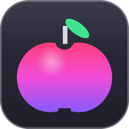
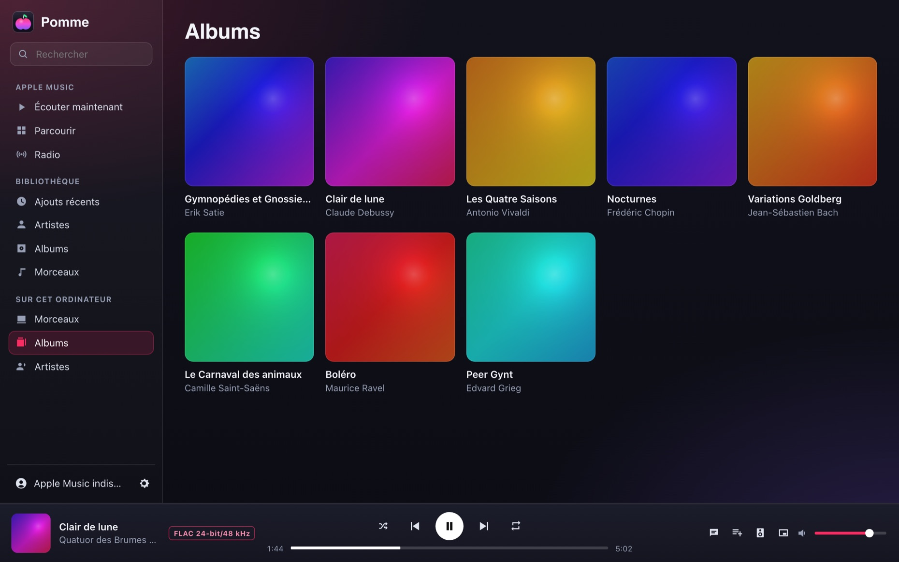
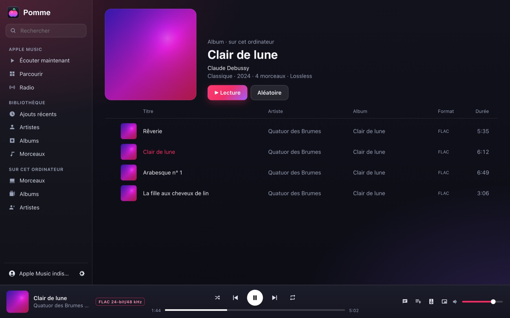
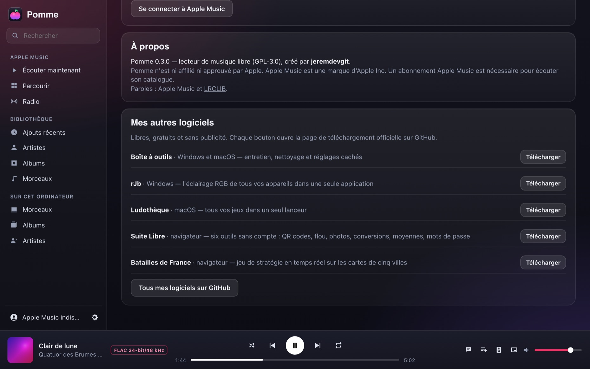
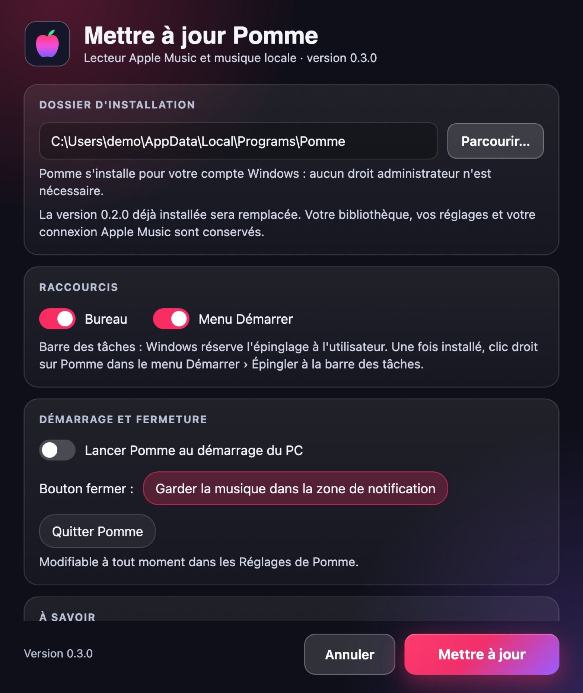

<p align="center"></p>

# Pomme

[English](README.md) · **Français** · [Español](README.es.md)

**Un lecteur de musique léger pour Windows : Apple Music et tes fichiers audio locaux dans la même fenêtre.** Bibliothèque, listes de lecture, paroles synchronisées, égaliseur, mini-lecteur, touches multimédia, statut Discord — dans une application d'une dizaine de mégaoctets, sans Electron.

**8 langues** : français, anglais, espagnol, allemand, italien, portugais, chinois et japonais. La langue de Windows est choisie automatiquement ; *Réglages › Langue* permet d'en changer (menu de la zone de notification compris).

👉 **[Télécharger Pomme pour Windows](https://github.com/jeremdevgit/pomme/releases/latest)** (`Pomme-Setup.exe`)



## Fonctionnalités

- **Apple Music** (abonnement nécessaire) : écouter maintenant, parcourir, radio, ta bibliothèque et tes playlists, recherche, création de playlists.
- **Musique sur l'ordinateur** : FLAC, ALAC, MP3, AAC/M4A, Ogg Vorbis, WAV, AIFF, CAF, MKA… avec pochettes, albums et artistes ; glisser-déposer de dossiers ou de fichiers ; lecture haute résolution (le format est affiché pendant la lecture).
- **Paroles** synchronisées en plein écran (Apple Music, ou LRCLIB pour les morceaux locaux — désactivable).
- **Égaliseur** 10 bandes avec préréglages, normalisation du volume, choix de la sortie audio, qualité de lecture réglable.
- **Mini-lecteur**, minuterie de mise en veille, touches multimédia et contrôles de Windows, zone de notification, lancement au démarrage.
- **Statut Discord** (« Écoute… ») avec titre, artiste, pochette et progression, si tu le souhaites.

<p> </p>

La diffusion réseau exige Windows 11 et un appareil compatible sur le même réseau local. La connexion AirPlay à PIN et la lecture de contenu protégé ne sont pas garanties.

## Installer

1. Télécharge `Pomme-Setup.exe` dans les [Releases](https://github.com/jeremdevgit/pomme/releases/latest) et lance-le.
2. Pomme s'installe **pour ton compte Windows, sans droits administrateur**. **Une version déjà installée est remplacée automatiquement** : bibliothèque, réglages et connexion Apple Music sont conservés.
3. Désinstallation depuis *Paramètres › Applications* (au choix : garder ou effacer bibliothèque et réglages).



L'exécutable n'est pas signé par un certificat payant : si Windows SmartScreen affiche « Windows a protégé votre ordinateur », clique sur **Informations complémentaires** puis **Exécuter quand même**. Pour vérifier le fichier : `Get-FileHash .\Pomme-Setup.exe` et compare avec `SHA256SUMS.txt`. Installation silencieuse : `Pomme-Setup.exe /S`.

Prérequis : Windows 10 ou 11 avec le moteur WebView2 (présent d'office sur Windows 11).

La diffusion réseau exige Windows 11 et un appareil compatible sur le même réseau local. La connexion AirPlay à PIN et la lecture de contenu protégé ne sont pas garanties.

## Vie privée et sécurité

- La diffusion réseau démarre uniquement après sélection d’un appareil. Une adresse locale temporaire sert à transmettre le son de Pomme à cet appareil.

- **Aucune télémétrie, aucun compte Pomme.** La connexion à Apple Music se fait sur la page officielle d'Apple ; la session reste dans le profil de Pomme sur ton PC.
- **Services contactés** : Apple Music (catalogue, lecture, paroles), LRCLIB pour les paroles des morceaux locaux (titre et artiste envoyés, désactivable), Discord en local si le statut est activé.
- L'interface ne reçoit des commandes que de ses propres pages ; les liens externes s'ouvrent dans ton navigateur.
- Pomme n'embarque aucune clé d'Apple : il utilise, comme le lecteur web d'Apple Music, le jeton public publié par music.apple.com.

Une faille ? Merci de lire [SECURITY.md](SECURITY.md).

## Compiler

Prérequis : [Rust](https://rustup.rs) stable et les *Build Tools* de Visual Studio (« Développement Desktop en C++ »).

```powershell
cargo build --release          # target\release\Pomme.exe (renommé Pomme-Setup.exe, il installe)
.\tools\release.ps1            # dist\Pomme-Setup.exe + contrôles (aucun chemin ni identifiant de la machine, aucune dépendance au Runtime Visual C++)
```

Les versions publiées sont construites par GitHub Actions ([`.github/workflows/windows.yml`](.github/workflows/windows.yml)).

## Structure du dépôt

```
src/          programme (Rust) : fenêtre WebView2, lecture audio (symphonia, cpal), bibliothèque locale, installateur
ui/           interface (HTML, CSS, JavaScript sans framework)
tools/        construction de la version distribuée
captures/     captures d'écran (bibliothèque fictive d'œuvres du domaine public ; captures/en : interface en anglais)
```

## Traductions

L'interface choisit sa langue (choix enregistré, sinon langue de Windows, sinon anglais) et se traduit une fois au chargement. Les textes sont dans `ui/textes/<langue>.js`, où le texte français sert de clé ; seule la langue choisie est chargée. Les quelques textes affichés par Windows lui-même (menu de la zone de notification, choix de dossier, installateur) sont dans `src/langue.rs` et `ui/setup.html`.

## Licence

Code sous licence **GNU GPL v3 ou ultérieure** — voir [LICENSE](LICENSE). Copyright © 2026 jeremdevgit.

Pomme n'est ni affilié ni approuvé par Apple. Apple Music est une marque d'Apple Inc. Les bibliothèques Rust utilisées (symphonia, cpal, wry, tao…) sont sous licences MIT / Apache-2.0 / MPL-2.0 ; la liste complète figure dans `Cargo.lock`.

## Mes autres logiciels

Tous libres, gratuits et sans publicité — [github.com/jeremdevgit](https://github.com/jeremdevgit) :

| Logiciel | Plateforme | En bref |
|---|---|---|
| [AutoDex](https://github.com/jeremdevgit/autodex) | Windows, macOS, Linux | Jeu de collection de voitures avec reconnaissance de photos sur l'appareil |
| [Boîte à outils](https://github.com/jeremdevgit/boite-a-outils) | Windows, macOS | Entretien de l'ordinateur, nettoyage et recherche de fichiers |
| [Carnet de notes](https://github.com/jeremdevgit/carnet-rust) | Windows | Carnets chiffrés et synchronisation expérimentale |
| [Decklight](https://github.com/jeremdevgit/decklight) | Windows, macOS, Linux | Stream Deck virtuel avec contrôle USB |
| [JMeca](https://github.com/jeremdevgit/jmeca) | Windows, macOS, Linux | Suivi d'entretien de véhicules chiffré |
| [LJ Hub](https://github.com/jeremdevgit/lj-hub) | Windows, macOS, Linux | Gestionnaire de profils pour appareils Logitech |
| [rJb](https://github.com/jeremdevgit/rjb) | Windows | Contrôle de l'éclairage RGB |
| [Ludothèque](https://github.com/jeremdevgit/ludotheque) | macOS | Bibliothèque et lanceur de jeux |
| [Suite Libre](https://jeremdevgit.github.io/suite-libre/) | Navigateur | Six outils sans compte |
| [Batailles de France](https://github.com/jeremdevgit/batailles-de-france) | Navigateur | Jeu de stratégie en temps réel |
