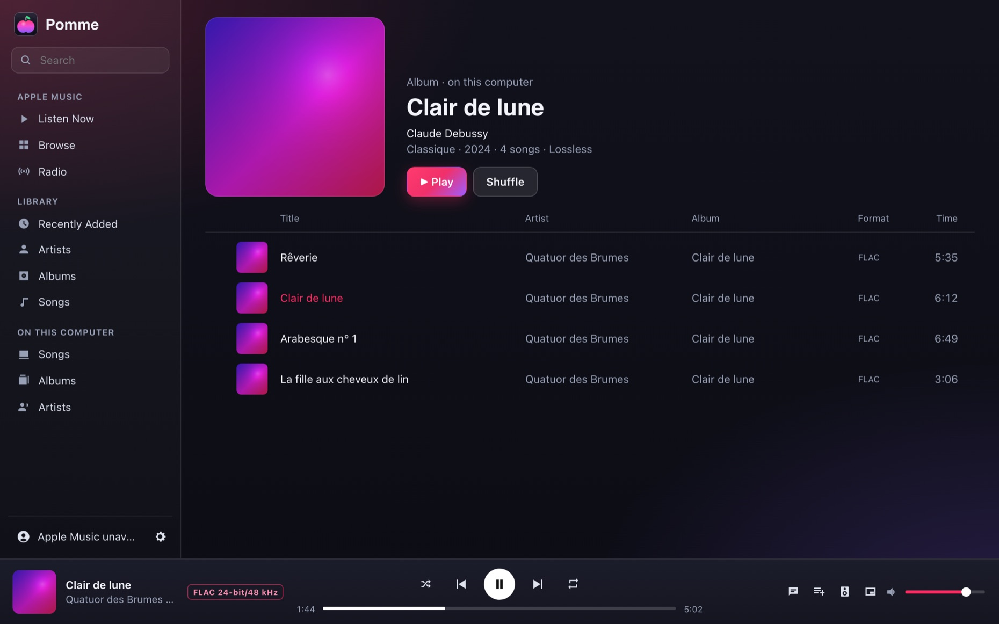

<p align="center"></p>

<h1 align="center">Pomme</h1>

<p align="center"><b>Apple Music とローカル音源のための軽量ミュージックプレーヤー：歌詞、イコライザー、ミニプレーヤー。</b></p>

<p align="center"> <a href="https://github.com/jeremdevgit/pomme/releases"></a> <a href="LICENSE"></a> <a href="https://github.com/jeremdevgit/pomme/actions/workflows/windows.yml"></a></p>

<p align="center"><a href="README.md">English</a> · <a href="README.fr.md">Français</a> · <a href="README.es.md">Español</a> · <a href="README.de.md">Deutsch</a> · <a href="README.it.md">Italiano</a> · <a href="README.pt.md">Português</a> · <a href="README.zh.md">简体中文</a> · <b>日本語</b></p>

<p align="center"><a href="https://github.com/jeremdevgit/pomme/releases/latest"><b>⬇ ダウンロード</b></a></p>


Apple Music と手持ちの音楽ファイルをひとつのウインドウで。アプリは約 10 MB、**Electron は使っていません**。

## 概要

| | |
|---|---|
| **カテゴリー** | 🎮 音楽とゲーム |
| **対応環境** | Windows |
| **表示言語** | 8 言語（英・仏・西・独・伊・葡・中・日） |
| **価格** | 無料・オープンソース・広告なし・テレメトリーなし |
| **ステータス** | 安定版 |
| **ライセンス** | [GPL-3.0-or-later](LICENSE) |

## 機能

- **Apple Music**（サブスクリプションが必要）：今すぐ聴く、見つける、ラジオ、ライブラリとプレイリスト、検索、プレイリスト作成。
- **手持ちのファイル**：FLAC、ALAC、MP3、AAC/M4A、Ogg Vorbis、WAV、AIFF、CAF、MKA など。アートワーク、アルバム、アーティスト表示、ドラッグ＆ドロップ、ハイレゾ再生。
- フルスクリーンの**同期歌詞**（Apple Music、ローカル曲は LRCLIB。オフにできます）。
- プリセット付き 10 バンド**イコライザー**、音量の均一化、出力先の選択、再生品質の設定。
- **ミニプレーヤー**、スリープタイマー、メディアキーと Windows のメディア操作、通知領域、自動起動。
- 必要に応じて **Discord ステータス**と、同じネットワーク上の対応レシーバーへの**ネットワーク配信**（Windows 11）。

<p> </p>

## はじめかた

1. [最新リリース](https://github.com/jeremdevgit/pomme/releases/latest)から `Pomme-Setup.exe` をダウンロードして実行します。Pomme は**管理者権限なしで、あなたのアカウントに**インストールされ、旧バージョンを置き換えてもライブラリ、設定、Apple Music のサインインは保持されます。
2. Apple 公式ページで Apple Music にサインインするか、音楽フォルダーをウインドウにドロップします。
3. アンインストールは *設定 › アプリ* から。ライブラリを残すか消すか選べます。

動作環境：Windows 10 または 11 と WebView2（Windows 11 は標準搭載）。有料証明書の署名はありません。SmartScreen が表示されたら **詳細情報 › 実行** を選んでください。`Get-FileHash` と `SHA256SUMS.txt` で確認できます。サイレントインストール：`Pomme-Setup.exe /S`。

## プライバシー

- **テレメトリーなし、Pomme のアカウントも不要。** Apple Music のセッションは PC 上の Pomme プロファイルに保存されます。
- 接続するサービス：Apple Music、ローカル曲の歌詞用 LRCLIB（曲名とアーティストのみ送信、オフ可）、ステータスを有効にした場合はローカルの Discord。ネットワーク配信はデバイスを選ぶまで始まりません。
- Pomme は Apple の鍵を同梱していません。Apple の Web プレーヤーと同じく、music.apple.com が公開しているトークンを使います。

## ソースからビルド

```powershell
# Rust stable + Visual Studio Build Tools (C++)
cargo build --release        # target\release\Pomme.exe
.\tools\release.ps1          # dist\Pomme-Setup.exe + チェック
```

翻訳は `ui/textes/<言語>.js` にあります（フランス語の文がキー）。公開版は GitHub Actions でビルドしています（[`windows.yml`](.github/workflows/windows.yml)）。

## ライセンス

GNU GPL v3 以降 — [LICENSE](LICENSE) を参照。Pomme は Apple と提携・承認関係にありません。Apple Music は Apple Inc. の商標です。使用している Rust ライブラリ（symphonia、cpal、wry、tao など）は MIT / Apache-2.0 / MPL-2.0 です。

---

脆弱性を見つけたら、公開 Issue ではなく非公開で報告してください（[SECURITY.md](SECURITY.md) を参照）。

## jeremdevgit のその他のフリーソフトウェア

すべて無料・オープンソース・広告なし。

**🛠️ システムとハードウェア** — [Boîte à outils](https://github.com/jeremdevgit/boite-a-outils) · [rJb](https://github.com/jeremdevgit/rjb) · [LJ Hub](https://github.com/jeremdevgit/lj-hub) · [Decklight](https://github.com/jeremdevgit/decklight)

**📒 生産性とデータ** — [Carnet de notes](https://github.com/jeremdevgit/carnet-rust) · [JMeca](https://github.com/jeremdevgit/jmeca) · [Suite Libre](https://jeremdevgit.github.io/suite-libre/)

**🎮 音楽とゲーム** — [Ludothèque](https://github.com/jeremdevgit/ludotheque) · [AutoDex](https://github.com/jeremdevgit/autodex) · [Batailles de France](https://github.com/jeremdevgit/batailles-de-france)
