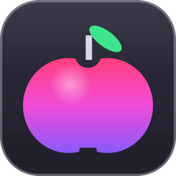
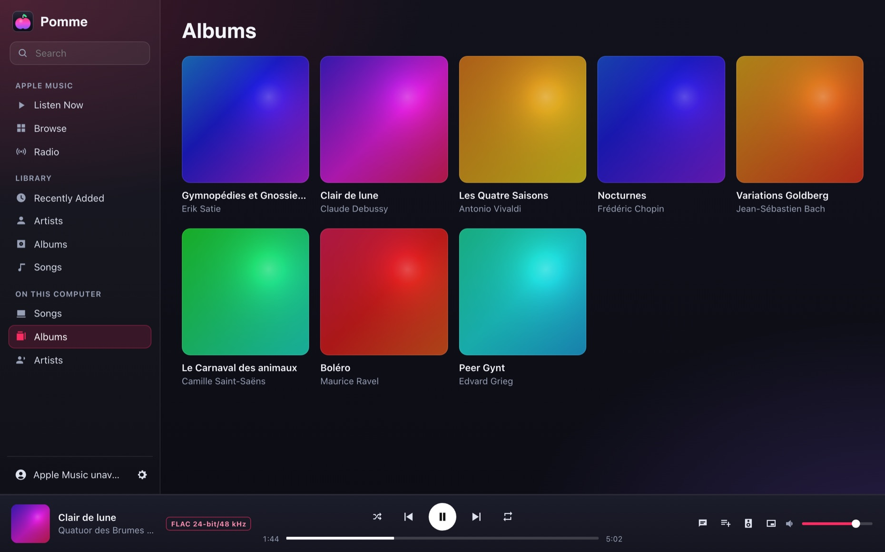
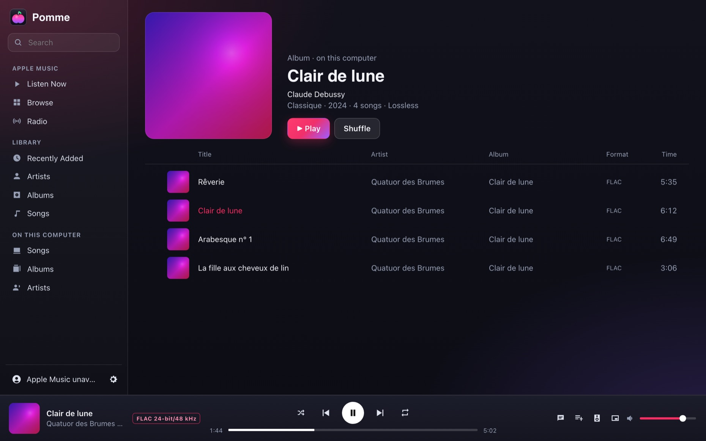
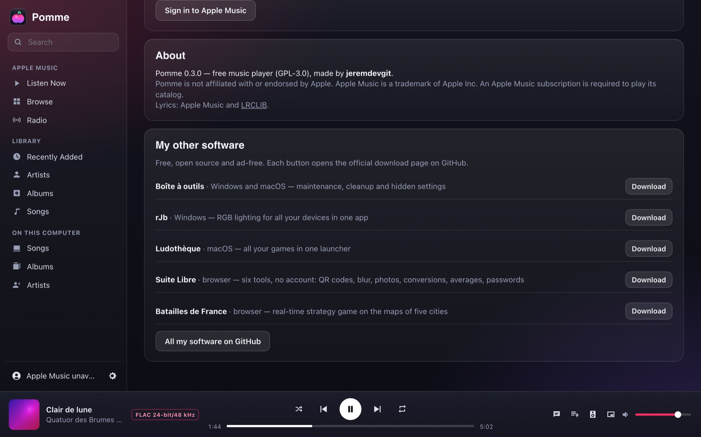
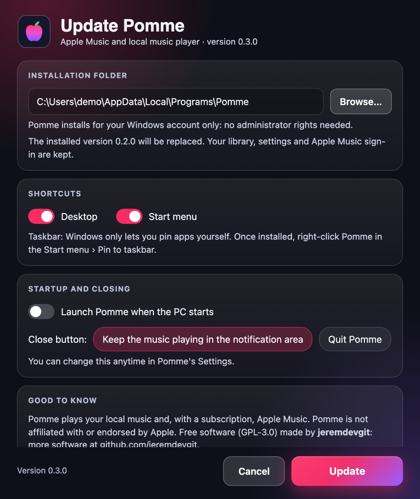

<p align="center"></p>

# Pomme

**English** · [Français](README.fr.md) · [Español](README.es.md)

**A lightweight music player for Windows: Apple Music and your local audio files in the same window.** Library, playlists, synced lyrics, equalizer, mini player, media keys, Discord status — in an app of about ten megabytes, with no Electron.

**8 languages**: English, French, Spanish, German, Italian, Portuguese, Chinese and Japanese. Windows' language is picked automatically; *Settings › Language* lets you switch (the notification area menu follows).

👉 **[Download Pomme for Windows](https://github.com/jeremdevgit/pomme/releases/latest)** (`Pomme-Setup.exe`)



## Features

- **Apple Music** (subscription required): Listen Now, Browse, Radio, your library and playlists, search, playlist creation.
- **Music on your computer**: FLAC, ALAC, MP3, AAC/M4A, Ogg Vorbis, WAV, AIFF, CAF, MKA… with artwork, albums and artists; drag and drop folders or files; high-resolution playback (the format is shown while playing).
- Full-screen **synced lyrics** (Apple Music, or LRCLIB for local songs — can be turned off).
- 10-band **equalizer** with presets, volume normalization, audio output choice, adjustable playback quality.
- **Mini player**, sleep timer, media keys and Windows controls, notification area, launch at startup.
- **Discord status** ("Listening to…") with title, artist, artwork and progress, if you want it.

<p> </p>

## Installing

1. Download `Pomme-Setup.exe` from the [Releases](https://github.com/jeremdevgit/pomme/releases/latest) page and run it.
2. Pomme installs **for your Windows account, without administrator rights**. **An installed version is replaced automatically**: library, settings and Apple Music sign-in are kept.
3. Uninstall from *Settings › Apps* (your choice: keep or erase library and settings).



The executable isn't signed with a paid certificate: if Windows SmartScreen shows "Windows protected your PC", click **More info** then **Run anyway**. To check the file: `Get-FileHash .\Pomme-Setup.exe` and compare with `SHA256SUMS.txt`. Silent install: `Pomme-Setup.exe /S`.

Requirements: Windows 10 or 11 with the WebView2 runtime (built into Windows 11).

## Privacy and security

- **No telemetry, no Pomme account.** Signing in to Apple Music happens on Apple's official page; the session stays in Pomme's profile on your PC.
- **Services contacted**: Apple Music (catalog, playback, lyrics), LRCLIB for local song lyrics (title and artist sent, can be turned off), Discord locally if the status is on.
- The interface only accepts commands from its own pages; external links open in your browser.
- Pomme ships no Apple key: like Apple Music's web player, it uses the public token published by music.apple.com.

Found a vulnerability? Please read [SECURITY.md](SECURITY.md).

## Building

Requirements: stable [Rust](https://rustup.rs) and the Visual Studio *Build Tools* ("Desktop development with C++").

```powershell
cargo build --release          # target\release\Pomme.exe (renamed Pomme-Setup.exe, it installs)
.\tools\release.ps1            # dist\Pomme-Setup.exe + checks (no machine path or identifier, no Visual C++ Runtime dependency)
```

Releases are built by GitHub Actions ([`.github/workflows/windows.yml`](.github/workflows/windows.yml)).

## Translations

The interface picks its language (saved choice, then Windows' language, then English) and translates itself once when it loads. Texts are in `ui/textes/<language>.js`, where the French text is the key; only the chosen language is loaded. The few texts shown by Windows itself (notification area menu, folder picker, installer) are in `src/langue.rs` and `ui/setup.html`.

## Repository layout

```
src/          program (Rust): WebView2 window, audio playback (symphonia, cpal), local library, installer
ui/           interface (HTML, CSS, framework-free JavaScript); ui/textes: translations
tools/        builds the distributed version
captures/     screenshots (fictional library of public-domain works; captures/en: English interface)
```

## License

Code under the **GNU GPL v3 or later** — see [LICENSE](LICENSE). Copyright © 2026 jeremdevgit.

Pomme is not affiliated with or endorsed by Apple. Apple Music is a trademark of Apple Inc. The Rust libraries used (symphonia, cpal, wry, tao…) are under MIT / Apache-2.0 / MPL-2.0 licenses; the full list is in `Cargo.lock`.

## My other software

All free, open source and ad-free — [github.com/jeremdevgit](https://github.com/jeremdevgit):

| Software | For | In short |
|---|---|---|
| [Boîte à outils](https://github.com/jeremdevgit/boite-a-outils) | Windows, macOS | maintenance, cleanup and hidden settings |
| [rJb](https://github.com/jeremdevgit/rjb) | Windows | RGB lighting for all your devices in one app |
| [Ludothèque](https://github.com/jeremdevgit/ludotheque) | macOS | all your games in one launcher |
| [Suite Libre](https://jeremdevgit.github.io/suite-libre/) | browser | six tools, no account: QR codes, blur, photos, conversions, averages, passwords |
| [Batailles de France](https://github.com/jeremdevgit/batailles-de-france) | browser | real-time strategy game on the maps of five French cities |
