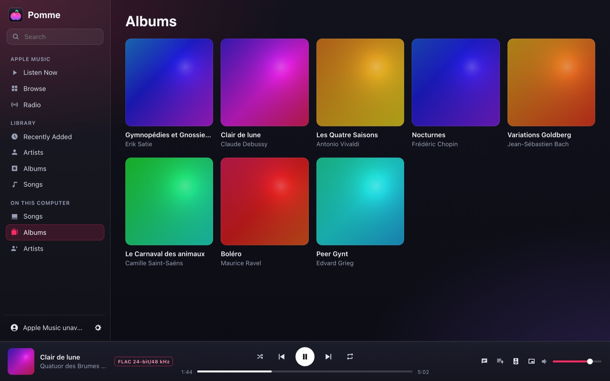
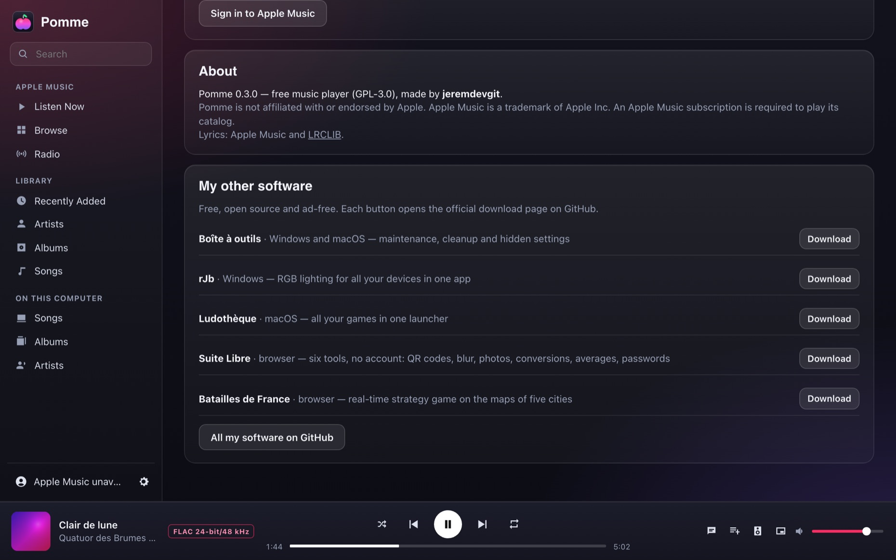

<p align="center"></p>

<h1 align="center">Pomme</h1>

<p align="center"><b>轻量的音乐播放器，支持 Apple Music 和本地音频：歌词、均衡器、迷你播放器。</b></p>

<p align="center"> <a href="https://github.com/jeremdevgit/pomme/releases"></a> <a href="LICENSE"></a> <a href="https://github.com/jeremdevgit/pomme/actions/workflows/windows.yml"></a></p>

<p align="center"><a href="README.md">English</a> · <a href="README.fr.md">Français</a> · <a href="README.es.md">Español</a> · <a href="README.de.md">Deutsch</a> · <a href="README.it.md">Italiano</a> · <a href="README.pt.md">Português</a> · <b>简体中文</b> · <a href="README.ja.md">日本語</a></p>

<p align="center"><a href="https://github.com/jeremdevgit/pomme/releases/latest"><b>⬇ 下载</b></a></p>



Apple Music 和你自己的音频文件在同一个窗口里，应用只有约十兆——**不用 Electron**。

## 概览

| | |
|---|---|
| **类别** | 🎮 音乐与游戏 |
| **平台** | Windows |
| **界面语言** | 8 种语言（英、法、西、德、意、葡、中、日） |
| **价格** | 免费、开源、无广告、无遥测 |
| **状态** | 稳定版 |
| **许可证** | [GPL-3.0-or-later](LICENSE) |

## 功能

- **Apple Music**（需订阅）：现在就听、浏览、广播、你的资料库和播放列表、搜索、新建播放列表。
- **你的音乐文件**：FLAC、ALAC、MP3、AAC/M4A、Ogg Vorbis、WAV、AIFF、CAF、MKA……支持封面、专辑和艺人；拖放导入；高解析度播放。
- 全屏**同步歌词**（Apple Music，或本地歌曲使用 LRCLIB——可关闭）。
- 10 段**均衡器**与预设、音量标准化、音频输出选择、播放质量设置。
- **迷你播放器**、睡眠定时、媒体键与 Windows 媒体控制、通知区域、开机启动。
- 可选的 **Discord 状态**，以及向同一网络中兼容接收器的**网络串流**（Windows 11）。

<p> </p>

## 开始使用

1. 从[最新版本](https://github.com/jeremdevgit/pomme/releases/latest)下载 `Pomme-Setup.exe` 并运行。Pomme **为当前账户安装，无需管理员权限**，会替换旧版本并保留资料库、设置和 Apple Music 登录状态。
2. 在 Apple 官方页面登录 Apple Music，或把音乐文件夹拖进窗口。
3. 在*设置 › 应用*中卸载，可选择保留或删除资料库。

系统要求：Windows 10 或 11，并装有 WebView2（Windows 11 已内置）。未使用付费证书签名：如出现 SmartScreen，请选择 **更多信息 › 仍要运行**。用 `Get-FileHash` 对照 `SHA256SUMS.txt` 校验。静默安装：`Pomme-Setup.exe /S`。

## 隐私

- **无遥测，无需 Pomme 账号。** 你的 Apple Music 会话保存在本机的 Pomme 配置中。
- 会连接的服务：Apple Music；本地歌词使用 LRCLIB（只发送歌名和艺人，可关闭）；开启状态显示时在本机连接 Discord。只有在你选择设备后才会开始网络串流。
- Pomme 不内置任何 Apple 密钥：与 Apple 的网页播放器一样，它使用 music.apple.com 公开发布的令牌。

## 从源码构建

```powershell
# Rust stable + Visual Studio Build Tools (C++)
cargo build --release        # target\release\Pomme.exe
.\tools\release.ps1          # dist\Pomme-Setup.exe + 检查
```

翻译位于 `ui/textes/<语言>.js`（以法语文本为键）。发布版本由 GitHub Actions 构建（[`windows.yml`](.github/workflows/windows.yml)）。

## 许可证

GNU GPL v3 或更高版本，见 [LICENSE](LICENSE)。Pomme 与 Apple 无关联，也未获 Apple 认可；Apple Music 是 Apple Inc. 的商标。所用 Rust 库（symphonia、cpal、wry、tao……）采用 MIT / Apache-2.0 / MPL-2.0 许可。

---

发现安全漏洞？请私下报告（见 [SECURITY.md](SECURITY.md)），不要发公开 issue。

## jeremdevgit 的其他自由软件

全部免费、开源、无广告。

**🛠️ 系统与硬件** — [Boîte à outils](https://github.com/jeremdevgit/boite-a-outils) · [rJb](https://github.com/jeremdevgit/rjb) · [LJ Hub](https://github.com/jeremdevgit/lj-hub) · [Decklight](https://github.com/jeremdevgit/decklight)

**📒 效率与数据** — [Carnet de notes](https://github.com/jeremdevgit/carnet-rust) · [JMeca](https://github.com/jeremdevgit/jmeca) · [Suite Libre](https://jeremdevgit.github.io/suite-libre/)

**🎮 音乐与游戏** — [Ludothèque](https://github.com/jeremdevgit/ludotheque) · [AutoDex](https://github.com/jeremdevgit/autodex) · [Batailles de France](https://github.com/jeremdevgit/batailles-de-france)
